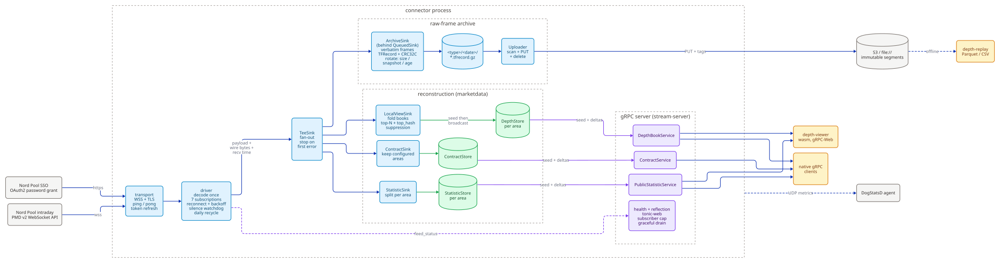

# nordpool-connector

**A real-time market-data system for the Nord Pool intraday electricity exchange, written in Rust.**
It keeps a live, exact copy of the exchange's order books, streams it to trading applications,
and records every message it receives so that any trading day can be replayed later.

> **About this repository.** I designed and wrote this system in 2026 while working with an
> energy-trading startup, where it ran in production on AWS. This copy contains the application
> code only: company deployment infrastructure (Terraform, CI/CD) and internal configuration have
> been removed, and the commit history has been squashed.

| | |
|---|---|
| **Scale** | ~21,000 lines of Rust in 5 crates · ~240 automated tests |
| **Techniques** | WebSockets + TLS, Protocol Buffers, gRPC streaming, order-book reconstruction, crash-safe storage, WebAssembly |
| **Companion project** | [`trading-system`](https://github.com/lvioleau/trading-system) — the trading services that consume these feeds |

## Background

Electricity is traded in **delivery periods**: a contract might be "1 MW delivered in France
between 14:00 and 14:15 tomorrow". On Nord Pool's *continuous intraday market*, buyers and
sellers trade these contracts right up to shortly before delivery, by posting orders into an
**order book**: a sorted list of everyone's bids and offers for each contract. There are
thousands of contracts open at any moment across Europe's delivery areas, each with its own book.

Nord Pool publishes this market data as a high-volume binary WebSocket stream. The stream does
not send whole order books. It sends a snapshot followed by a continuous series of small changes
("order 123 added at €87.40", "order 456 removed"). A trading program has to apply every change
in the right order to know what the market currently looks like. Missing or misreading one
message silently corrupts the picture, and the trading decisions built on it.

This system solves that problem once, centrally, so that trading applications don't have to.

## What I built



1. **A resilient exchange connection.** It authenticates (OAuth2), opens the WebSocket, subscribes
   to seven feeds across one or more delivery areas, and keeps the session healthy: keep-alive
   pings, detection of a connection that is alive but has stopped delivering data, automatic
   reconnection with exponential backoff, and token refresh mid-session.
2. **Order-book reconstruction.** Every change is applied to an in-memory model of each book,
   which is checked for internal consistency as it goes.
3. **Streaming feeds for downstream programs.** Three gRPC streaming services publish the top of
   every order book, the reference data for every contract, and trading statistics. A new
   subscriber receives the complete current state first, then every change after it.
4. **A complete, replayable archive.** Every message is stored byte-for-byte as received, with
   checksums, in compressed files uploaded to S3. A separate tool replays any day from the archive
   and produces analysis-ready Parquet tables for research and back-testing.
5. **A live browser viewer.** A WebAssembly app shows the order books and trades in real time.

Cargo workspace with five crates:

- **`crates/connector/`** — the connector proper: WebSocket transport, driver, sinks, binary entry. Also reconstructs order books and hosts the gRPC server in-process.
- **`crates/marketdata/`** — pure domain: L2 order books, the `DepthView` (top-N) projection, the contract and statistic stores. No protobuf or IO deps.
- **`crates/stream-server/`** — the gRPC server library: three streaming services (depth, contracts, statistics), each seeding new subscribers with current state then forwarding live deltas.
- **`crates/depth-replay/`** — offline batch tool: reads archive segments back (S3, `file://`, or a local dir) and dumps reconstructed depth or contract reference data to Parquet, or a CSV summary of the delivery areas.
- **`crates/depth-viewer/`** — WebAssembly eframe/egui viewer served in the browser: renders live depth, statistics, and volume over gRPC-Web. Built with trunk.


## Key design decisions

These are the decisions that shaped the system, and the reasoning behind each.

**Rebuild each order book once, centrally.** Every trading application needs order books, but
rebuilding them correctly from the raw stream is subtle. Instead of each application doing it
(and getting it slightly differently wrong), the connector does it once and publishes ready-made
books. Reconstruction lives in a *pure* domain crate (`crates/marketdata`) with no networking, no
I/O and no protobuf, so the core logic can be tested in isolation.

**No gaps, no duplicates, no blocking.** A subscriber that joins mid-stream must end up with
exactly the right state. The publisher always updates the stored snapshot *before* announcing a
change, and a subscriber always starts listening *before* reading the snapshot. Overlap is
therefore possible but loss is not, and a per-message sequence number lets the server discard the
overlap. A subscriber too slow to keep up is disconnected and re-synchronises from a fresh
snapshot, so one slow client can never slow down the exchange connection or the other clients.

**Record the raw truth, derive everything else.** The archive stores the exchange's original
bytes, never a re-encoded version, so a bug in my processing can always be fixed and the history
reprocessed. Files are chunked so that each daily block starts with a full snapshot and can be
replayed on its own, and checksums detect a file truncated by a crash.

**Decide explicitly what each failure should cost.** I went through the failure cases one by
one:
- A failing archive disk does not stop the live feeds. Traders shouldn't lose market data
  because of a storage problem. The write is retried for a bounded time, then the frame is
  counted as lost.
- A *full* disk does stop the process. Unlike a passing fault it will not fix itself, so it is
  surfaced loudly instead.
- Queues between components are bounded. When one is full the system drops archive data rather
  than stall the exchange connection.

These rules are written down and tested.

**Respect the exchange's constraints.** Nord Pool allows one connection per account, so running
two connectors for redundancy is impossible. The design accepts a single process and puts
resilience into fast, automatic recovery and into clients that re-synchronise themselves.

**Make the system observable.** Its health is exposed through a standard gRPC health check that
reports whether the upstream feed is live, not just whether the process is running. Metrics cover
message rates, reconnects, queue depth, archive backlog and subscriber lag.

## Correctness and testing

About 240 automated tests run in under a second:
- unit tests for the order-book rules, including the exchange's edge cases (iceberg orders,
  modifications that keep or lose queue priority);
- tests for every failure path in the connection driver (stale connections, silent servers,
  expiring tokens, disk faults);
- the streaming services, tested directly on domain types;
- integration tests that run a real TLS WebSocket server locally, to exercise the full network
  path.

## Where to look first

| If you want to see… | Look at |
|---|---|
| The order-book model | [`crates/marketdata/src/orderbook.rs`](crates/marketdata/src/orderbook.rs) |
| Connection handling, reconnection, failure modes | [`crates/connector/src/driver.rs`](crates/connector/src/driver.rs) |
| Gap-free streaming to subscribers | [`crates/stream-server/src/feed.rs`](crates/stream-server/src/feed.rs), [`crates/connector/src/sink/localview.rs`](crates/connector/src/sink/localview.rs) |
| Crash-safe archiving | [`crates/connector/src/sink/archive.rs`](crates/connector/src/sink/archive.rs) |
| Engineering conventions and invariants | [`AGENTS.md`](AGENTS.md) |

---

# Technical reference

The rest of this document is the operational reference for running and configuring the system.

## Data flow

<sub>Source: [`docs/architecture.d2`](docs/architecture.d2) — regenerate with `d2 --layout elk --pad 20 docs/architecture.d2 docs/architecture.svg`.</sub>

The raw-frame archive always runs (`[connector.archive] dir` is required, and an empty one fails config load); the feed trio and the gRPC server are gated on `[server] listen_addr`, and the S3 upload on the nested `[connector.archive.upload] uri`. The metrics export is always installed — DogStatsD is UDP, so with no agent the packets simply drop.

## What it does

1. Fetches an OAuth2 bearer token from Nord Pool SSO (password grant), refreshed mid-session before expiry.
2. Opens a `wss://` WebSocket and issues seven subscriptions in one shot (`subscribe_all`):

   | Variant           | Scope                                                        |
   | ----------------- | ------------------------------------------------------------ |
   | `LocalView`       | Per configured area (`[connector] delivery_area`, one EIC code or a comma-separated list) |
   | `PublicStatistic` | Per configured area                                          |
   | `Contract`        | Global (snapshot + delta)                                    |
   | `DeliveryArea`    | Global (always full snapshot)                                |
   | `Ticker`          | Global (snapshot + delta)                                    |
   | `AtcCapacity` / `H2hCapacity` | Per area, wildcard connected areas               |

3. Fans every frame out through a `TeeSink`: the archive always; the feed trio (`LocalViewSink` + `ContractSink` + `StatisticSink`) plus the gRPC server when `[server] listen_addr` is set.
4. Stays alive: pings every 10s (stale after 20s without a pong), reconnects on recoverable errors with exponential backoff (500ms → 30s), fresh token + session per attempt. With `session_reconnect` (`daily`/`<seconds>`) it also recycles the session deliberately so the re-subscribe pulls fresh snapshots and each period's archive starts a self-contained, snapshot-led block.
5. Shuts down cleanly on SIGINT/SIGTERM/SIGHUP: the open archive segment is finalized, the upload queue drained, the WebSocket closed.

## The gRPC feeds

The in-process tonic server (gated on `[server] listen_addr`, package `nordpool.marketdata.v1`, with server reflection and the standard `grpc.health.v1` health service — the server-wide `""` service reports `SERVING`, probed by monitoring such as the Datadog agent's `grpc_check`) hosts three server-streaming services. All three follow the same shape: on subscribe the client is **seeded** with full current state, then forwarded live **delta batches** (each stamped with the frame's receive time); a subscriber that can't keep up is **dropped** (`RESOURCE_EXHAUSTED`) and reconnects to re-seed. A `tonic-web` layer makes the same feeds reachable from browsers (gRPC-Web).

- **`DepthBookService.Subscribe`** — top-N depth (`[server] depth` levels per side, default 20), reconstructed from the `LocalView` feed. The request's `eic_code` (ENTSO-E EIC, e.g. `10YFI-1--------U`) selects one of the served areas (`NOT_FOUND` otherwise). A book is only re-sent when its visible top actually changes (digest-based suppression); each message is full state for the changed books of one frame, so gaps self-heal on the next send.
- **`ContractService.SubscribeContracts`** — contract reference data, filtered by the request's `eic_codes` set: only contracts trading in at least one requested area are streamed, each carrying its state per configured area. An empty set is rejected `INVALID_ARGUMENT`. The connector keeps contracts trading in at least one configured area, trimmed to the configured areas' states.
- **`PublicStatisticService.SubscribeStatistics`** — per-contract trading statistics (last/high/low/VWAP/turnover, day-ahead price), area-keyed like depth; the request selects the area.

View the feeds with the web depth-viewer, or explore the API by hand — reflection means neither needs proto files (both tools are in the dev shell):

```sh
open http://localhost:8080                           # the stack's depth viewer (baked wasm bundle + Caddy)
grpcui -plaintext -port 8082 localhost:50051         # browser UI: per-method forms, streaming responses
grpcurl -plaintext localhost:50051 list              # CLI: list services; invoke with JSON bodies
grpcurl -plaintext localhost:50051 grpc.health.v1.Health/Check   # expect {"status": "SERVING"}
```

> **Feed semantics — `order_id` and `created_at_ms`.** On the `LocalView` feed: a modify with a priority change arrives as cancel + new order (new `order_id`); a modify without one keeps the `order_id` but changes `created_at_ms`; an iceberg clip fill keeps both (possibly with a new price). So under a stable `order_id`: `created_at_ms` changed ⇒ modify, unchanged ⇒ clip fill. All three are normal; the reconstruction only warns on genuinely inconsistent input (e.g. a removal below empty).

## Configuration

All config lives in one INI file — [`nordpool.ini`](nordpool.ini), or wherever `NORDPOOL_CONFIG` points — loaded once at startup. **Nothing else in the code reads the environment.** Values may embed `${VAR}` (required) or `${VAR:-default}` references, resolved from the process environment at load. Secrets are never stored in the file — the file names the variable; the value is injected at deploy time (Terraform in prod, the run script in dev). The connector links no AWS SDK.

| Section               | Purpose |
| --------------------- | ------- |
| `[connector]`         | `ws_host`/`ws_port`, `delivery_area` (one EIC code or a comma-separated list, resolved to Nord Pool's numeric wire ids via the `EicCode` enum), `session_reconnect` (`off`\|`daily`\|`<seconds>`), and the liveness/backoff/timeout tunables (ping/pong/read/write/handshake/connected timeouts, token refresh margin, backoff curve) |
| `[connector.auth]`    | OAuth2 `token_url`, `client_id`, `client_secret`, `scope`, `username`, `password` (all from `${NORDPOOL_MARKET_DATA_API_*}`) |
| `[connector.metrics]` | `dogstatsd_addr` (required; no on/off gate — UDP, so packets drop silently without an agent), `tags`, `book_state_period_secs` (gauge cadence). Drives the `nordpool.*` series: frames/bytes, reconnects, book/contract/statistic state, feed subscribers, archive + uploader, queue depth. |
| `[connector.archive]` | `dir` (required, no default — the archive always runs; an empty or unresolved one fails config load), segment rotation/durability (`block_size_mib`, `segment_max_age_secs`, `fsync_interval_secs`), `write_retry_secs` (how long a refusing disk is ridden out before frames are lost), the writer queue |
| `[connector.archive.upload]` | The shipper, gated on `uri` (empty or the whole section absent ⇒ off; `s3://bucket/prefix` or `file:///abs/path`) — every other key here is required once it is set: `scan_interval_secs`, `concurrency` (segments in flight per pass, each holding its whole segment in memory), `max_backoff_secs` (ceiling on a failing segment's retry backoff), the per-PUT retry budget, `shutdown_grace_secs`, and `tags` (static S3 object tags, `key=value` — the only tags a PUT carries; empty ⇒ no tagging header) |
| `[server]`            | `listen_addr` (empty ⇒ feeds off), `broadcast_capacity`, `depth` (levels per side), `max_subscribers` (per-service cap) |

Deliberately env-only, not in the INI: logging (`RUST_LOG`; JSON to stdout).

## Archive & replay

`ArchiveSink` writes each frame's verbatim wire bytes plus its receive time as TFRecord-framed records (per-record CRC32C, readable by standard TFRecord tooling), each segment starting with a self-describing header record, one rotating segment per frame type under `<dir>/<type>/<date>/`. Segments finalize (fsync + gzip `.tfrecord.partial`→`.tfrecord.gz`) at `block_size_mib`, on a snapshot (fresh file), on shutdown, or once open for `segment_max_age_secs` (default 15 min — every arriving frame sweeps all types' open segments, so busy feeds close quiet feeds' aged ones, and no new file opens until that type gets data); orphaned partials are compressed on startup. The frames are never re-encoded, so a reader can decode them directly as PMD `ServerFrame`s with unknown fields preserved.

When `[connector.archive.upload] uri` is set, an in-process uploader ships each finalized segment to object storage (S3 in prod via the task role, MinIO in the dev stack), mirroring the local `<type>/<date>/<name>` layout and deleting each local copy once it is safely stored — the object store is the archive of record, the local dir a staging area, so whatever is still on disk after a pass is exactly the backlog (`nordpool.archive.pending_uploads`). Open partials are never uploaded — the age-based rotation bounds hard-kill loss to about `segment_max_age_secs` plus one scan interval. Uploads are at-least-once; a segment that fails is retried on a per-segment exponential backoff (one scan interval, doubling, capped at `max_backoff_secs`), so a store outage doesn't re-read and re-PUT the whole backlog every scan — and nothing is ever abandoned. Every PUT carries the configured `tags` and nothing else — the uploader reads nothing out of a segment's path, so the `<type>/<date>/` layout stays the writer's alone; the date is still selectable as part of the object key.

`depth-replay` reads the same layout back — from S3, `file://`, or a local dir, optionally narrowed to one `--date` — and dumps Parquet: reconstructed top-of-book depth (`--frame-type localview`, with per-book event-time throttling and `--levels` per side) or contract reference data (`--frame-type contract`). `--frame-type delivery-area` instead summarizes the current delivery areas — folding just the latest snapshot-led segments — into a CSV, one row per area. It refuses to start from a replay range that isn't snapshot-led.

A localview replay reconstructs **one delivery area**: the archive multiplexes every subscribed area into a single stream, so `--eic-code` selects the one to replay and the rest are skipped. Omit it for a single-area archive — the first frame's area is used, and a second area fails the run rather than silently interleaving two areas into one file. Each row identifies its book the way the domain does, `eic_code` + `market_type` + `contract_id`, so rows stay unambiguous once several areas' files are concatenated, and each level carries the same `created_at` / `updated_at` receive stamps the live feed publishes.

## Running locally

Locally the whole stack runs under `podman compose` from [`compose.yaml`](compose.yaml) — MinIO (S3 stand-in, buckets bootstrapped), a Datadog agent (grpc_check baked into a derived image), and the connector — via [`scripts/dev-stack.sh`](scripts/dev-stack.sh), which fetches the secret bundle and delegates to compose (on macOS, start `podman machine` first).

```sh
# Nord Pool test environment; creds fetched from Secrets Manager via aws-vault.
scripts/dev-stack.sh                     # up --build; defaults: PROFILE=nordpool-dev, ENV_FILE=connector.dev.env
scripts/dev-stack.sh logs -f connector
scripts/dev-stack.sh down                # stop the stack (MinIO data volume kept)
```

- **Env files** (`connector.dev.env` is a committed template — fill in your own Nord Pool credentials; other `*.env` files are gitignored) supply the `${VAR}` references in `nordpool.ini`. Values are literal — no surrounding quotes.
- **Secrets**: the wrapper fetches the Secrets Manager bundle on the host via `aws-vault` (SSO) using `PROFILE`, normalizes key names, and exports each entry for compose; values already in the env file win. The role needs `secretsmanager:GetSecretValue`. Only `up`/`run`/`create` fetch — `down`, `logs`, `ps` skip aws-vault.
- **Networking**: one compose network; services reach each other by name (`minio:9000`, `dd-agent:8125`, `connector:50051`), identically on macOS and Linux. Ports 9000/9001, 8125/udp, and 50051 are also published to the host for native tools (`grpcui`, `mc`, the MinIO console).
- **Archive**: segments stage in the container's own `/data/archive` (ephemeral) and ship to `s3://nordpool-archive-<env>` on MinIO, `<env>` derived from `PROFILE`; a hard-killed container loses at most ~`segment_max_age_secs` of test feed.
- **Logs**: JSON to stdout; `scripts/dev-stack.sh logs -f connector` (pipe through `jq .` to pretty-print).
- **Viewer**: the stack serves the browser depth viewer at `http://localhost:8080` (Caddy + baked wasm bundle, gRPC-Web proxied to the connector). For iterating on viewer code use `trunk serve` from `crates/depth-viewer` instead: hot reload, proxying to the stack's published `localhost:50051` (see `Trunk.toml`).

For iterating on code, run the binary directly — `cargo run -p nordpool-connector` reads `./nordpool.ini` and the dev-shell env (`ARCHIVE_DIR` has no default — point it at a writable local dir, or config load fails; set `GRPC_LISTEN_ADDR` there too to enable the feeds; the published DogStatsD/MinIO ports serve native runs too). Always pass `-p`: the workspace has several binaries. Other dev tools in `scripts/`: `dd-agent-stats.sh` (DogStatsD traffic snapshot from the running agent).

## Production

In production the connector ran as a single container on AWS (ECS Fargate). The deployment
infrastructure is not part of this repository, but two deliberate constraints shaped it:

- **Config and credentials are injected, never fetched.** Every `${VAR}` in `nordpool.ini` is supplied as an environment variable by the orchestrator (secrets from a secrets manager, plain values inline). The app makes no secrets-manager calls and links no AWS SDK.
- **AWS access is IAM, not keys.** The archive uploader reaches S3 through [`object_store`](https://docs.rs/object_store)'s env credential chain — the task role. The same code path writes to `file://` in dev.

## Testing

```sh
cargo test --workspace     # ~220 tests, sub-second
```

Unit tests live inline in the module they cover (driver, config, each sink, the order-book domain, all three streaming services — the latter tested directly on domain types, no network). Two transport integration tests stand up a local `wss://` server with a self-signed cert and exercise the full TLS + WebSocket path; a third locks in tungstenite's auto-pong behavior.
